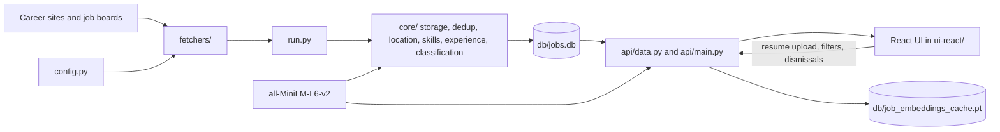

# Architecture and code guide

This document describes the code in this repository as it currently works. Read it with [README.md](README.md) for setup and [improvement.md](improvement.md) for proposed work. Planned items in the improvement roadmap are not part of the current system.

## System boundary

Job Intel is a **local, single-user** application. It has two separate execution paths:

1. `python run.py` collects and processes postings, then writes `db/jobs.db`.
2. FastAPI reads that database and serves a React UI. The user may upload a resume to rank the saved postings.

There is no background scheduler, hosted service, login system, application submission bot, or cloud database. Run commands from the repository root because the Python code uses relative `db/` paths. Collection is the network step; parsing, matching, and the UI run locally. To enforce offline mode, download the model with `python scripts/download_model.py` once, then set `JOB_INTEL_OFFLINE=1`. Normal collection refuses to run in that mode; `--process-only` remains available.

On Windows, `Start Job Intel.cmd` invokes `start.py` from the repository root. After the one-time Python setup, the launcher builds the React bundle if missing or stale, starts the localhost FastAPI server if it is not already responding, opens the browser, and starts one collection process. It skips collection when `JOB_INTEL_OFFLINE=1`. A database-specific file lock prevents overlapping collections. The launcher verifies both checkout path and a source fingerprint of the running backend; an outdated or different checkout produces an explicit restart instruction. It is not a scheduler or process supervisor.



The embedding cache is generated locally. The React client does not fetch career sites itself.


Unstop is not registered as a collector. The API excludes all previously saved Unstop rows from results without deleting local SQLite history.


The Atlassian adapter reads its first-party listings endpoint and builds first-party `/company/careers/details/{id}` links. The endpoint's `applyUrl` points to an iCIMS application dialog and is unsuitable for the job card. Existing saved Atlassian URLs are normalized when the API loads them; a later collector run also refreshes saved locations and descriptions while keeping job IDs and dismissals. A failed listings request now raises a source error instead of appearing as an empty successful fetch.

The Bank of America adapter reads the public JSON requests behind the general and student India search pages. The site's offset query currently returns no rows after the first page, so the adapter requests up to 1,000 results from offset zero and checks the count against the reported total. It deduplicates requisition IDs and reads each public detail page for the description. A valid zero-result student search is successful; a truncated response, failed request, or missing description makes the source partial when other jobs were fetched.

The Google Careers adapter collects one India search with repeated `target_level=EARLY` and `target_level=INTERN_AND_APPRENTICE` parameters. It parses server-rendered cards, follows the displayed total through pages of 20 with a 50-page safety limit, and deduplicates job IDs. Its description contains the card's level and minimum qualifications rather than full detail-page text. Missing pages or result counts mark the source partial. Previously collected rows remain in local SQLite history.

Mastercard is collected from both its Phenom careers site and the `CorporateCareers` Workday page. The dedicated `mastercard_workday` source discovers India location IDs from Workday's current facet response, fetches all India listing pages, and reads full job descriptions. It runs before Phenom; both feeds use `mastercard:R-...` as the stable ID, so overlapping postings are saved once and Phenom can still supply postings absent from Workday. When an existing Phenom row receives a full Workday description, its source, URL, and content are refreshed while its ID and dismissal stay intact. A failed page or description produces a partial Mastercard Workday run.

Barclays collects every page of its public India search using `?p=` and reads official job descriptions. Posting IDs are deduplicated; incomplete pages, totals, or descriptions produce a partial source result.

Amazon collects the complete India search with `industry_experience=less_than_1_year` and no keyword restriction. It follows the JSON endpoint's reported total, retaining descriptions and qualifications. Failed pages, repeated pages, deadlines, or the 1,000-page safety limit produce partial source results. The app applies its existing filters after collection.

Microsoft uses India Intern and Entry searches with remote jobs included and relocation excluded. The PCSX endpoint treats a comma-separated seniority value literally, so two searches implement the selected levels and overlapping posting IDs are deduplicated. Earlier saved Microsoft rows remain in SQLite.

American Express uses the India location facet `300000000228786` from its branded careers URL through the existing Oracle endpoint. Pagination and full-description collection remain active.

Flipkart collects the public TurboHire feed linked from its official career navigation, with full descriptions, source experience, and skills. An anonymous API token is obtained in memory without an account. The static `/jobslist` page has truncated cards and nonfunctional Show More code, so its displayed count is not used. Missing records or descriptions produce partial results.

Meta Careers collects the logged-out search for Mumbai, Gurgaon, Bangalore, Hyderabad, and New Delhi offices without a role restriction, including internship roles when published. The student directory links to the same offices with `roles[0]=Internship`; this is a navigation filter, not an additional collector. It discovers current public GraphQL search operations from the delivered frontend assets, requests all results, verifies the reported count, and reads descriptions, responsibilities, and qualifications from job-page structured data. Missing totals or descriptions produce partial results; unavailable search operations fail the source.

Uber collects the public `countries=India` search API, follows its page counts, deduplicates posting IDs, and stores included full descriptions. Missing pages, count mismatches, descriptions, or deadline interruptions produce partial results.

## Repository map

| Path | Responsibility |
| --- | --- |
| `config.py` | Configured companies, ATS tenants, display names, location and title patterns. |
| `fetchers/` | One adapter per ATS or site; handles HTTP, pagination, parsing, and source-specific fields. |
| `fetchers/http_client.py` | Shared JSON/text request helpers with retries for rate limits, server errors, and timeouts. Some older fetchers still have their own request code. |
| `core/collector.py` | `PLATFORMS` registry mapping source names to collector calls. `collect_all()` is a diagnostic helper; normal runs use `run.py`. |
| `run.py` | Main collection and processing entry point. Fetches platforms concurrently, writes sequentially, then enriches unprocessed rows. |
| `core/storage.py` | SQLite schema, migrations, job IDs, inserts, dismissal, skill overrides, run stats, and cleanup. |
| `core/dedup.py`, `core/location.py` | Repost key and location parsing. |
| `core/classify.py`, `core/skills.py`, `core/experience.py` | Job category, recognized skills, and minimum experience extraction. |
| `core/embeddings.py`, `core/matcher.py`, `core/resume_text.py` | Shared model loader, resume-to-job ranking and embedding cache, resume text extraction. |
| `api/main.py`, `api/data.py` | HTTP endpoints and SQLite/DataFrame-to-JSON adapter; currently loaded resume and scores live in process memory. |
| `ui-react/src/` | React components, browser-side filtering and display, API wrapper, and explicit TypeScript response types. |
| `stats.py`, `debug/` | Local diagnostics. |

`core/filters.py` contains an older `matches()` hard filter but **normal collection does not call it**. The older `config.INCLUDE` and `config.EXCLUDE` patterns are not save-time gates. Do not describe them as active collection filters.

## Collection path

### Fetcher contract

Each collector returns job dictionaries with the common fields below. The collector passes the source name separately to `save_job()`.

```python
{
    "company": "example",
    "source_id": "source posting ID",  # may be absent for some sources
    "title": "Data Analyst",
    "location": "Delhi, India",
    "url": "https://...",
    "description": "Source description text or HTML",
}
```

The `standard` adapter handles Greenhouse, Lever, and Ashby. Its HTTP connection pool matches its 16 board-fetch workers. Postman was removed from Greenhouse after a 404. PhonePe is now collected through SmartRecruiters. Other adapters cover Oracle, Workday, SmartRecruiters, SuccessFactors, Phenom, iCIMS, Eightfold, Workable, Bank of America, Google Careers, Amazon, and several company-specific sites. Most use public JSON endpoints; some parse HTML. An adapter must normalize the same fields even if its source uses different names. `config.WORKABLE` is currently empty, so the registered Workable collector is reported as skipped rather than as a successful zero-job fetch.

### What `python run.py` does

1. `init_db()` creates or migrates SQLite tables. The database directory is created at `run.py` import time.
2. `run.py` preloads existing IDs and repost keys from **all** saved jobs, including dismissed ones.
3. It submits every entry in `core.collector.PLATFORMS` to a thread pool with one shared deadline (`RUN_DEADLINE_SECONDS`, default 600 seconds). Network fetching overlaps; SQLite writes happen in the main thread.
4. For each returned posting, it drops locations confidently outside India. The parser recognizes country names, US state names and abbreviations, and several unambiguous US city-only locations. Unknown locations are kept. It updates `last_seen` for an existing `job_id`, then checks the repost key for new IDs, then inserts new jobs. Matching existing Atlassian rows refresh their URLs, locations, and descriptions. Missing postings are never automatically marked closed.
5. It writes one `run_stats` row per platform. A raised platform error receives `status='failed'`; the standard ATS and Mastercard Workday collectors can also return `status='partial'` when some boards, pages, or descriptions fail. Their reasons are saved in `run_stats.error`. Some other platforms still return plain job lists and cannot yet signal internal partial failure. The legacy `jobs_matched` statistic currently equals `jobs_fetched` and is **not** a count of resume matches.
6. `process_backlog()` fills missing category, skills, and experience fields. The three processors have separate error handling, so a classification failure does not prevent skill or experience extraction.
7. It removes rows whose `first_seen` is older than 365 days. This is age-based cleanup, not verification that a posting is still open.

The stable ID is `company:source_id` when the source provides an ID; otherwise it is a hash of company, title, and URL. The repost key is `(company, normalized title, parsed city, normalized description fingerprint)`. It can catch a repost with a new source ID, but it is not a perfect cross-site identity system. Dismissed jobs remain in dedup sets so they do not reappear simply because an employer reposted them.

The API applies the same India-or-unknown country rule when loading previously saved jobs. This hides older foreign rows after a parser correction without deleting them from SQLite. The React location checkboxes are additional user filters, not the country gate.

### Enrichment

- **Category:** `core/classify.py` embeds each job's title and description and compares it with short category descriptions. It uses the shared `all-MiniLM-L6-v2` model. A low best similarity falls back to `Other`.
- **Skills:** `core/skills.py` uses case-insensitive regular expressions over a curated skill list plus any custom keywords stored in SQLite. This is keyword extraction, not an ML skill parser. Jobs store comma-separated recognized skills.
- **Experience:** `core/experience.py` looks near mentions of “experience” for year requirements and distinguishes required from preferred wording. `NULL` means not processed; `-1` means processed but unknown; `0` is an explicit fresher signal; positive values are extracted minimum years. Mixed-track postings can still be misread.

`process_backlog()` only handles rows with a `NULL` value in one of those fields. Updating an extraction rule does not automatically rewrite already processed jobs; use the relevant reprocess command.

## SQLite and local state

`core/storage.py:init_db()` owns the schema and simple additive migrations:

| Table | Important fields | Purpose |
| --- | --- | --- |
| `jobs` | `id`, `company`, `title`, `location`, `url`, `description`, `source`, `first_seen`, `last_seen`, `dismissed`, `category`, `skills`, `experience_years` | Saved postings and derived fields. `last_seen` is the latest observation of an exact source ID, not confirmed open status. The `score` column is legacy and not the current resume match. |
| `run_stats` | `run_id`, `timestamp`, `platform`, fetched/saved counts, runtime, `status`, `error` | Per-platform collection history. |
| `custom_skills` | `skill` | User-added terms used by the regex skill extractor. |
| `resume_skill_overrides` | `resume_key`, `skills` | Corrected skill set keyed by SHA-256 of the uploaded file bytes. |

`db/jobs.db` and `db/job_embeddings_cache.pt` are ignored by Git. The full resume text is **not stored in SQLite**: `api/data.py` keeps the current resume text, key, skill set, and per-job scores in a module-level `_resume` dictionary. Restarting the API clears that live state; saved skill overrides remain in SQLite. This design is only suitable for one local user and one API process.

## Resume upload and ranking

1. React sends a PDF, DOCX, or TXT file to `POST /api/resume` as multipart form data. The API rejects unsupported extensions and files larger than 5 MB.
2. `api/main.py` hashes the file bytes and adapts FastAPI's `UploadFile` to the file-like interface of `core/resume_text.py`.
3. The parser uses PyMuPDF for PDF text, `python-docx` for paragraphs and table cells, and UTF-8 decoding for TXT. Empty extracted text is rejected. There is no OCR for scanned PDFs.
4. The API extracts recognized resume skills. If `resume_skill_overrides` has a saved set for the file hash, that corrected set takes precedence.
5. `api/data.py:set_resume()` calls `rescore()`. It loads or incrementally computes job embeddings and calls `rank_by_resume()`.
6. Scores are held in memory as `{job_id: match_pct}` and included in later `/api/jobs` responses. Changed job content, skills, locations, or visible IDs trigger rescoring when list/detail payloads are requested. Resume state and scoring use one reentrant lock, and failed replacement restores the preceding resume state.

`core/embeddings.py` lazily loads one `all-MiniLM-L6-v2` model for classification and matching within each Python process. It prefers the project-local `models/all-MiniLM-L6-v2`; outside strict offline mode it can still download the model on first use if that directory is absent. Job embeddings represent two parsed sections with token-bounded chunk pooling, described below. The model sequence limit is 512 tokens, while matching chunks use 192 content tokens. Each cached job embedding is keyed by job ID plus a versioned content hash, so unchanged jobs do not need to be re-embedded; the cache is saved with PyTorch under `db/`.

The matcher now separates required qualifications from responsibilities and preferred qualifications. It tokenizes every selected section into chunks of at most 192 tokens, embeds all chunks locally, and mean-pools each section. Resume skills plus projects/work are compared with job requirements; projects/work are separately compared with responsibilities. If headings are absent, it falls back to available text and explains that limitation. No leading-character truncation is applied; source descriptions may themselves still be incomplete. A long section is averaged, so this is section relevance rather than proof that each requirement is satisfied.

Semantic relevance uses the existing fixed cosine range 0.15–0.65. With recognizable projects/work, requirements contribute 55% and responsibilities 45% of the semantic component; otherwise only requirements relevance is used. Recognized required skills have weight 3, unclassified skills 2, preferred skills 1. The weighted skill component contributes up to 40%, scaled down when fewer than three skills are known. The existing target-title-or-40%-skill relevance gate still caps unrelated roles at 10. These weights are provisional heuristics, not measured probabilities.

The cache content hash includes `sections-v3`, invalidating previous single-vector embeddings automatically. Cached job tensors now have two section vectors. API resume state stores scores and `match_explanation` maps; list and detail responses include explanations, component scores, required skill gaps and separate eligibility checks. Clearing a resume clears explanations too. React shows a “Why this ranking?” expander. No database schema changes are needed.

Eligibility remains evidence-based and separate from sorting: India location is checked against the existing country parser; professional experience is compared only when the resume explicitly states years of work/professional/industry experience. Project dates do not count as employment. Education and ambiguous graduation/student requirements are shown for review with unknown status. A single explicit graduation year in the required section can be compared with a single explicit resume graduation year; dates or year ranges alone are not compared. The parser does not infer degree equivalence or approve overall eligibility. Missing recognized required skills are evidence gaps, not proof of inability. Unknown is never approval.

The React sidebar calls `PUT /api/resume/skills` to save corrections to the current resume and rescore. The API also exposes custom-skill endpoints, but the React UI does not yet manage the global custom-skill vocabulary. Existing job skill lists require `--reprocess-skills` after that vocabulary changes.

## HTTP and browser behavior

`api/main.py` defines the endpoints; `api/data.py` creates list and detail payloads. Main routes:

| Route | Behavior |
| --- | --- |
| `GET /api/jobs`, `GET /api/jobs/{id}` | Lists all non-dismissed jobs, then fetches description and experience lines for one job on demand. The list omits descriptions to reduce payload size. |
| `GET /api/stats` | Count of visible jobs, distinct companies, and whether a resume is loaded. |
| `POST /api/resume`, `GET /api/resume`, `DELETE /api/resume` | Upload and score a resume; inspect or clear process-memory resume state. |
| `PUT /api/resume/skills` | Save a corrected skill set for the current resume and rescore. |
| `GET/POST /api/custom-skills`, `DELETE /api/custom-skills/{skill}` | Read, add, or remove custom skill terms. Existing job rows need `--reprocess-skills` after taxonomy changes. |
| `POST /api/jobs/{id}/dismiss`, `POST /api/jobs/dismiss-bulk` | Persist `dismissed=1` and invalidate the 30-second job DataFrame cache. |

The API reads non-dismissed jobs from SQLite into a Pandas DataFrame, computes derived location flags and the `is_senior` flag, then serializes list rows. `ui-react/src/types.ts` manually mirrors those JSON fields. Update both sides when the API contract changes.

The React app fetches the full list once per refresh and filters in browser memory. Its default filter hides jobs with **2 or more years required or preferred**; jobs with both values unknown (`-1`) stay visible. Location text is a substring search; Remote/NCR/India checkboxes combine with OR. With a resume loaded it hides scores below 20 and sorts by score; otherwise it sorts by `first_seen`. It displays 40 rows at first and reveals more in batches. Opening a job link dismisses it only when the optional auto-remove toggle is enabled; the toggle defaults to off. Dismissal is stored in SQLite. The React UI does not currently distinguish “applied” from “not interested.”

In development, Vite on port 5173 proxies `/api` to FastAPI on `127.0.0.1:8000`. After `npm run build`, `api/main.py` serves the `ui-react/dist` index and assets from the API origin. The built directory is generated and ignored by Git.

## Commands and change points

| Task | Command or file |
| --- | --- |
| Fetch and process postings | `python run.py` |
| Process only rows with missing derived fields | `python run.py --process-only` |
| Recalculate every job's skill list | `python run.py --reprocess-skills` |
| Recalculate every job's experience requirement | `python run.py --reprocess-experience` |
| Remove jobs older than 365 days | `python run.py --cleanup` (also runs after a normal collection) |
| Inspect collection history | `python stats.py`, `python stats.py --summary`, `python stats.py --all`, or `python stats.py --health` |
| Add or change a company | Edit `config.py` and the relevant `fetchers/` adapter. |
| Add a platform | Write an adapter returning the common job dictionary, then register it in `core/collector.py`. |
| Change score behavior | Inspect `core/matcher.py`, `core/skills.py`, `config.TARGET_ROLE_RE`, and the browser's fixed 20-point display threshold together. |
| Change UI fields | Update `api/data.py`, `api/main.py`, `ui-react/src/types.ts`, and consuming components together. |

The offline fixture tests in `tests/` cover Greenhouse, source-health classification, and the `run_stats` migration. Run `python -m unittest discover -s tests -v`. `python -m compileall -q api core fetchers run.py stats.py` checks syntax; `npm ci && npm run build` checks the React build. Live source behavior requires separate network checks because source sites can change. There is no CI yet.

## Important limits

- A stored posting is not guaranteed to be open today; `last_seen` records an observation, but there is no confirmed-closed workflow. Old rows migrated from earlier versions start with `last_seen = first_seen`.
- Save-time filtering only rejects confidently non-India locations. Unknown locations are kept and treated as potentially India-relevant in the UI.
- Resume scoring and category assignment have no labeled evaluation in this repo. Match percentages are ranking heuristics.
- The API has no authentication, per-user state, or multi-user isolation. Resume uploads are limited to 5 MB and browser mutations reject unexpected origins. Bind it to localhost.
- Browser application automation and automatic submission are not implemented.

Use [improvement.md](improvement.md) for proposed changes, not as evidence that those features already work.

### Airbnb collection

Airbnb uses the existing standard Greenhouse collector (`airbnb` board). The board returns all postings in one request with descriptions; `run.py` applies the shared India-or-unknown location filter before saving. The five India posting IDs on the official filtered careers page matched the feed during verification. App filters can hide saved roles based on experience or resume matching.

LinkedIn and Internshala collectors and sidebar links have been removed. The API hides all saved rows with their current or historical source labels; SQLite history is preserved.

Deloitte collects the official Deloitte India category `/go/Deloitte-India/718244/`, following all pages of 25 listings (up to 120 pages) and fetching descriptions with four workers. Missing pages, totals, descriptions, or deadline interruptions produce partial source health. Existing India, seniority, and resume filters apply after collection. This source does not cover the separate Deloitte USI portal.

Graviton Research Capital LLP is collected through the `gravitonresearchcapital` Greenhouse board linked by its official careers page. The live board is used instead of the site-hosted snapshot. Descriptions are included, existing India filters apply, and a valid empty jobs list is a successful fetch.

Tower Research Capital uses its official `towerresearchcapital` Greenhouse board, including descriptions. A dedicated wrapper adds country names to its known city-only location labels, preserving mixed India/overseas postings for the existing India filter. Unknown locations remain available for review. Empty boards are valid; failed requests raise source errors.

PhonePe uses SmartRecruiters tenant `PHONEPELIMITED`, verified against the 89 PUBLIC postings linked by the official careers feed. The existing adapter reads listing pages and descriptions. India ISO country code `in` is normalized to `India` to prevent confusion with the US state abbreviation.

Swiggy collects the public NextHire `reqlist/get` response used by its careers frontend, with the same careers payload. All returned postings are read in one request, deduplicated by reqId, with included descriptions and source minimum experience. Links use the frontend job-detail context. Invalid responses fail the source; malformed listings or missing descriptions produce partial results; valid empty lists succeed. The API supplies no independent total, so coverage is verified against its returned list rather than a separate vacancy count.

ZS Associates uses the public `/api/jobs` endpoint with the requested Bengaluru, Gurgaon, Noida and Pune filters. The adapter follows totalCount pagination, deduplicates IDs, includes descriptions, and uses first-party `/all/jobs/{slug}` links. Failed initial requests raise errors; interrupted pages, missing totals or descriptions produce partial results.

Rippling collects every page of its public careers search index, discovering the frontend search configuration in memory without storing keys. It deduplicates India postings by jobId, merges locations and reads public job-page descriptions. Missing pages, totals or descriptions produce partial results; configuration changes fail visibly. D. E. Shaw India reads regularJobs embedded in the official careers page, excluding exploratory applications and inactive entries; descriptions include responsibilities and qualifications. Quadeye reads the first-party Zoho-backed job-openings response used by its careers frontend, including descriptions, country fields and specific job links; no recruiter metadata is stored. The latter two feeds expose no independent total. Existing India and app filters apply. LinkedIn remains removed.

See [SOURCE_VERIFICATION.md](SOURCE_VERIFICATION.md) for the dated live checks, source counts, and current access/description limitations.

Rubrik Engineering and Information Technology & Services department pages are covered by the existing complete Greenhouse board. No extra collector is needed. Rubrik city-only locations gain the India country label when the posting's office metadata explicitly names India; the source city is preserved. Verified department India counts: Engineering 8, IT & Services 3.

### Additional company feeds (2026-10-02)

Arcesium uses its official `arcesiumllc` Greenhouse board; confirmed India city labels are normalized without changing foreign locations. Intuit uses the India country facet at `https://jobs.intuit.com/location/india-jobs/27595/1269750/2`, paginates all result pages, and fetches descriptions with four workers. Interrupted pagination or missing descriptions produces a partial result. Walmart Workday `IN ` locations and `(IND)` titles are normalized as India; `(USA)` titles identify US roles. Ambiguous multiple-location entries use public detail country metadata before filtering. Salesforce, Walmart and Palo Alto Networks now request full descriptions for India or unknown locations. Adobe remains a Phenom feed with description teasers; ServiceNow uses SmartRecruiters and Snowflake uses Ashby.

### PayPal, BlackRock and fintech source checks (2026-10-02)

PayPal has a dedicated public Workday collector (`fetchers/paypal.py`) for the `paypal/jobs` board. It discovers India location facets from the live response, paginates the scoped listings and reads full descriptions. Its requisition IDs use `R` followed by digits, without Mastercard's dash. BlackRock (`fetchers/blackrock.py`) reads all pages of its official India country facet at `https://careers.blackrock.com/location/india-jobs/45831/1269750/2` and full `.ats-description` sections; country normalization follows the country facet rather than guessing from cities. Both sources report incomplete pages or descriptions as partial.

Groww remains on Greenhouse; CRED and Meesho remain on Lever with full descriptions. Confirmed city labels on those two Lever boards are normalized to India, while foreign or unknown labels remain unchanged. Morgan Stanley remains on Eightfold with department summaries rather than full descriptions. Expedia remains on its official paginated HTML feed with team summaries; failed listing requests now raise a source failure if no jobs were collected, or return partial status if earlier pages succeeded. HTTP 403 responses were observed during verification, so Expedia is currently intermittent.

### Additional India company sources (2026-10-02)

- Greenhouse: AlphaGrep (`alphagrepsecurities`), NK Securities Research (`nksecuritiesresearch`), WorldQuant, IMC, Optiver (`optiverus`), MongoDB and Datadog. These newly added boards retain only confirmed India listings; source-specific city-only labels for AlphaGrep, WorldQuant and MongoDB are normalized before country filtering. Unresolved locations such as AlphaGrep's multiple-location submissions are omitted rather than classified as India. Existing Greenhouse board behavior is unchanged.
- Ashby: Confluent (`confluent`), scoped to India. Its branded site returned HTTP 429 during discovery; this is the current public Ashby board, not a guarantee of coverage of every hiring channel.
- `fetchers/jibe.py` supplies shared India pagination and full-description normalization for `amd.py` and `booking.py`. The public listing APIs are `careers.amd.com/api/jobs` and `jobs.booking.com/api/jobs`; country metadata takes precedence over building-specific location names. Missing pages, counts or descriptions make collection partial.
- `target.py` collects all pages of `indiajobs.target.com/search-jobs` with `?p=`, then reads full descriptions. Its India site omits card city labels, so location is India.
- `tesco.py` reads the official India search linked by Tesco Bengaluru, follows `jobOffset` pagination, checks the displayed total, and reads description fields with four workers. It includes Tesco India roles beyond technology; normal role filters still apply.
- `mediatek.py` uses the public `job.getJobs` tRPC query on `yourcareers.mediatek.com`. It checks all global result pages against the reported total, retaining Noida, Bangalore/Bengaluru and Mumbai offices. It reads the displayed city from `properties.location.code` (the API's `label` is a numeric identifier). Descriptions and model inference remain local after collection.
- `millennium.py` uses the public legacy Eightfold `/api/apply/v2/jobs` India search on `career.mlp.com`. The PCSX API is not enabled for that tenant. Listings contain department summaries, not full descriptions; count or page interruptions are partial.
- `juspay.py` monitors Juspay's official `/careers` page. Its explicit no-openings state is a successful empty collection; unavailable pages or unrecognized markup are failures. New detail markup is treated as partial pending location verification.

All source counts are live snapshots. None of these collectors applies to jobs or requires account credentials. Use `python run.py` to write new jobs to SQLite. Existing local database history is preserved.


## Requested company audit (2026-10-02)

See [COMPANY_SOURCE_AUDIT.md](COMPANY_SOURCE_AUDIT.md) for all 75 companies and live results; [COMPANY_SOURCES.json](COMPANY_SOURCES.json) defines the audit manifest. Run `python scripts/audit_company_sources.py` to refresh JSON without writing jobs to SQLite.

New India-scoped Workday collectors discover country/location facets for Broadcom, CrowdStrike, Cohesity and Postman, paginate and fetch descriptions. New Greenhouse boards cover Roku, Glean, Okta, Pure Storage, GitLab, Squarepoint and QRT. Dedicated collectors cover Netflix, Bloomberg, HRT, Automattic and Zerodha. LinkedIn employer-only guest search is explicitly partial with missing descriptions and no reliable total; the general LinkedIn job-board source remains removed. Swiggy and ZS location normalization now preserves recognized India locations.

Three companies have no verified working collector: Indeed employer, Citadel Securities and Zomato. Empty feeds, inaccessible feeds and partial results remain distinct. Automattic remote eligibility needs individual review; Zerodha nonempty schema must be verified when vacancies appear.


### Zepto Darwinbox (2026-10-02)

`fetchers/zepto.py` reads the public Darwinbox careers page with normal browser headers, then POSTs read-only listing queries to `/ms/candidateapi/job/alljobs`. It paginates against `job_counts`, normalizes source IDs and locations, decodes the full `jd`, and returns partial status for missing descriptions, malformed rows or interrupted pages. The verified live result is one Bengaluru operations job. Existing role/experience filters may exclude it. No login or application submission is used.


## UnitedHealth Group / Optum (2026-10-02)

`fetchers/unitedhealthgroup.py` collects the supplied official India keyword search through the public TalentBrew `/search-jobs/results` AJAX endpoint. Ordinary pagination links returned unrelated results, so the collector validates the requested page number and India keyword on every AJAX page, compares source totals, deduplicates IDs, and retrieves full descriptions from JobPosting structured data (longest ATS description fallback).

The live check scanned 253 search matches and returned 249 recognized India jobs, all with descriptions. Four foreign keyword matches were excluded. India location normalization requires an explicit country or a recognized Indian state; unresolved locations are excluded. This is additional to the original 75-company audit manifest. Interrupted pagination or missing descriptions returns partial status. Existing role/experience/UI filters determine which collected jobs are displayed.


## Description-based experience filtering (2026-10-04)

The default UI filter hides jobs whose description states a minimum of 2+ years. It retains 0-year, 1-year and unknown requirements. Senior/lead/manager titles no longer hide jobs or offer bulk removal. Titles are not evidence that a job accepts freshers. Experience extraction uses descriptions only, and the API re-derives the value for existing rows without rewriting SQLite. Unknown does not mean fresher eligible; preferred-only requirements remain unknown. The regex parser can miss ambiguous requirements and alternate qualification tracks, so review the original description.


## KLA India Workday (2026-10-04)

KLA is registered in `WORKDAY_INDIA` with tenant `kla`, server `wd1` and site `Search`. The shared collector discovers the board-specific India country facet, paginates and retrieves full descriptions. The supplied country value is `c4f78be1a8f14da0ab49ce1162348a5e`; hardcoding the generic `locationCountry` facet fails on this board, so facet discovery is required. Live verification returned 57 India jobs with 57 descriptions and status `ok`. Existing role and description-based experience filters apply after collection.


## Long qualification requirements (2026-10-05)

Experience extraction recognizes Basic/Required/Minimum Qualifications separately from Preferred Qualifications. Long year-to-experience clauses within required sections are supported; preferred sections cannot provide a hard minimum. The Amazon Risk Manager II example resolves to 4 years required, not its 3-year preference. Amazon truncates narrative background separately while retaining qualification sections. Existing saved descriptions are re-evaluated by the API; previously truncated descriptions require recollection to recover missing text. The parser remains heuristic for alternative qualification tracks.


### Experience section headings (2026-10-05)

The experience parser also recognizes explicit `Experience:` sections. Bosch Data Provisioning Expert (744000149775909) resolves to 5 required years; a separate preference for global-team collaboration does not override that minimum. An explicitly preferred numeric requirement remains unknown rather than a mandatory minimum.


## Windows launchers

- `Start Job Intel.cmd`: opens the site and launches `python run.py` to collect jobs (collection is skipped in offline mode).
- `Open Job Intel.cmd`: opens the site using saved jobs, without running the scraper. It calls `start.py --no-scrape`.

Both launchers build the UI if needed and start or reuse the localhost API. Double-click the desired `.cmd` file.


## Eligibility evidence and new jobs (2026-10-05)

Job details now expose an `eligibility` object from `core/eligibility.py`: description-based minimum experience, education and graduation-year evidence, explicitly mandatory skill evidence and missing recognized skills relative to the current resume. These are heuristic hints for review, not eligibility approval. Missing evidence stays unknown; preferred sections are excluded from mandatory skill extraction. No personal academic profile is inferred.

Job summaries include `first_seen_ms` (UTC milliseconds). React offers New since last visit, Refresh jobs and Mark current jobs reviewed. A localStorage checkpoint is recorded only after a successful initial load; the prior checkpoint stays fixed for that visit. First-time users see all saved jobs as new. Mark reviewed resets the boundary without dismissing jobs. State is browser-local; disabled storage loses the checkpoint between visits. Counts include all loaded jobs before other filters.

## Student opportunity discovery

The UI includes a collapsible directory of official student pages for the 30 companies and a title-based intern/apprentice/student checkbox. Amazon adds India `intern` and `apprentice` searches without the industry-experience facet; its collector deduplicates overlaps. Directory links are not vacancy records or proof of eligibility. See [STUDENT_PROGRAMS.md](STUDENT_PROGRAMS.md) for verified pages and separate-portal coverage gaps.

Morgan Stanley student programs use a separate `morgan_stanley_students` collector, reading the public `careerservice/resultset.json` endpoint with `opportunity=sg&lang=en`. The frontend paginates the complete returned array locally; the adapter verifies `totalResults`, selects explicitly India-based rows, retains descriptions and qualifications, and uses the program number as the stable ID. Missing totals, rows or descriptions mark the result partial; malformed or failed requests raise an error. The existing Eightfold India collector remains active.

### Additional student sources

The student directory contains 30 searchable company entries. `workday_students` uses `config.WORKDAY_STUDENTS` with the existing Workday India adapter. Visa's separate `Visa_Early_Careers` board collects all India roles. Walmart verifies complete India listing pagination before selecting `STUDENT_TITLE_RE` matches and fetching their descriptions; its original Global Tech search remains connected. Selection does not prove eligibility. Industrial trainee and co-op titles are included; generic graduate full-time roles are not student-title matches. IDs remain company plus requisition ID, with no new database schema. `STUDENT_PROGRAMS.md` and `STUDENT_SOURCE_AUDIT.json` record coverage and manual-only gaps. The API does not scrape program pages on UI access.

### Qualcomm India internships

`qualcomm_students` follows the supplied India `Intern` search with remote and relocation disabled and distance sorting. It verifies the count and paginates the public PCSX listing endpoint, then reads full `JobPosting` structured descriptions from first-party detail pages. Checked 2026-10-05: 2 roles, Interim Engineering Intern_2027_HW and Interim Engineering Intern_2027_SW. The earlier title count missed these underscore-separated names; the UI now normalizes underscores before student-title matching. The original general Qualcomm collector stays active. Matching saved Qualcomm IDs receive updated descriptions and reset derived enrichment fields while preserving first-seen time and dismissals. Missing descriptions or interrupted listing requests are partial; valid empty searches are successful. Program-year text is not proof of graduation eligibility.

### Netomi India searches

Netomi is registered in `config.LEVER` and collected through the existing `standard` adapter. Its public Lever board supplies both requested searches: `Remote - India` and `Gurugram`. Only those exact source locations are selected; Gurugram is normalized to `Gurugram, India`. Generic Remote and foreign locations are excluded. Descriptions combine the main text, qualification/responsibility lists and additional text, using the existing 6,000-character cap. Lever posting IDs deduplicate the board without fetching each search separately. Checked 2026-10-06: 5 Remote - India and 6 Gurugram postings. Local experience and resume filters still apply; these counts are not eligibility counts.

### Portcast India coverage

Portcast is registered in `config.LEVER`. Its Lever records can have a foreign primary `categories.location` while `categories.allLocations` lists supported Indian cities. The adapter selects explicit India locations or confirmed Delhi/Bangalore/Bengaluru/Chennai/Hyderabad/Kolkata/Mumbai labels from both fields, normalizes city-only labels to India, and excludes postings without a supported Indian location. Descriptions and qualifications use the existing Lever parser and 6,000-character cap. Checked 2026-10-06: 9 of 11 postings list Indian locations, including Data Analyst Intern whose primary location is Singapore. Normal experience and resume filters still apply; listing an Indian location does not establish applicant eligibility.

### Foreign country recognition

The shared location parser recognizes Morocco and additional explicit foreign-country labels observed in the BCG Phenom feed (including Egypt, Indonesia, Kenya, Azerbaijan, Hungary, South Africa, Colombia, Chile, Belgium, Malaysia, Czechia, Thailand, Norway, Vietnam, Peru, Greece, Türkiye and Republic of Korea). This corrects BCG requisition 56429, Delivery AI Data Engineering Intern in Casablanca, Morocco, which previously passed as Unknown. The same parser gates collection and existing API rows, so an API restart hides affected saved foreign jobs without deleting history or requiring recollection. India-containing multi-location postings and genuinely unknown locations remain visible under the existing policy. The parser remains heuristic, not an exhaustive geographic resolver.

### Ranking evaluation

`scripts/evaluate_matcher.py` accepts a local JSON file containing resume_text and jobs graded 0 (poor), 1 (partial), or 2 (good relevance). It reports precision@10 and NDCG@10 without writing resumes, SQLite, or the embedding cache. Use 30–50 representative jobs, keep a separate holdout set, and compare metrics across matcher versions before tuning weights. Current automated checks cover controlled examples and real-model execution, not measured quality on a user-labeled job sample. No cross-encoder reranker is introduced in this version.

### Required and preferred experience visibility

The default experience filter hides postings when either the required minimum or the preferred experience lower bound is 2+ years. Preferred years are parsed separately by `extract_preferred_experience`, exposed as `preferred_experience_years` (-1 for unknown), and displayed as preferred rather than mandatory. The same rule applies to the experience bulk-removal count and action. Switching the filter off reveals these saved jobs; filtering does not delete SQLite rows. API loading recomputes both fields from saved descriptions, so restart the backend and refresh after updating; collection is unnecessary.

### Complete descriptions and experience clauses

Greenhouse and SuccessFactors preserve complete normalized descriptions. Escaped HTML is decoded before stripping tags, preventing markup from consuming the old text budget. Existing rows collected by `standard` or `successfactors` refresh changed nonempty descriptions during later runs, reset derived enrichment for reprocessing, and retain dismissal and first-seen state. Empty fetch results never replace a saved description. Existing truncated rows need a successful source refresh to recover missing text.

Experience parsing checks a year/experience clause when the legacy nearby-word scan finds no minimum, so a preceding certification preference such as “a plus” cannot erase the next bullet's numeric work requirement. Preferred sections remain excluded from mandatory minimums and are exposed separately.

## Organized local folder and review fixes (2026-10-07)

The local outer folder contains `Start Job Intel.cmd`, `Open Job Intel.cmd`, `app/`, and the existing `.venv/`. All source, documentation, tests, SQLite state and the source-only Git checkout are inside `app/`. `.venv` stays outside to preserve Windows activation and installed command entrypoints. The original Git metadata is preserved inside `app/.git`; `app/public-release` remains the separate GitHub checkout. Source exports/clones can keep the original flat layout: the CMD launchers detect both layouts, and start.py accepts a project-local or parent virtual environment.

Run manual commands from `app/` after activating `..\.venv\Scripts\Activate.ps1`, or use `..\.venv\Scripts\python.exe run.py`. Database and embedding cache paths for API, collection and stats are now anchored to the source directory rather than the shell's working directory. `start.py --check` verifies launcher paths without starting an API, browser or scraper. `/api/runtime` returns the root and source identity captured at API import; it is a launcher diagnostic, not UI profile data.

Collection commits each platform result before waiting for the next future, avoiding long SQLite write locks. Standard boards check the shared deadline before starting each queued board; already-running HTTP calls retain their own timeout/retry budget. Full Lever/Ashby descriptions now join Greenhouse/SuccessFactors without the old 6,000-character cap. Changed Deloitte descriptions refresh too. Source-specific refetch commands reset derived fields and process the backlog after obtaining nonempty descriptions. Empty fetches never replace saved text.

Experience parsing takes the strongest independent numeric requirement, retaining the lower bound of a range or explicitly stated alternatives. Decimal years are preserved as numbers end to end; the browser compares against `>= 2`, so 1.5 years remains visible. This remains a heuristic, and mixed eligibility tracks need review. Preferred-only descriptions remain available to semantic section comparison; version 3 invalidates prior title-only embeddings. Graduation ranges/alternatives remain unknown.

Expanded job details reload when the job list or resume changes, discard obsolete request responses, and clear retry errors. Resume removal and skill controls respect busy/error state. The lockfile updates source-map-js to a patched release. `REPO_REVIEW.md` records verification and remaining limits.
