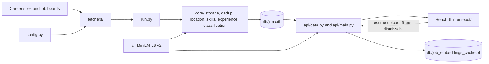

# Architecture and code guide

This document describes the code in this repository as it currently works. Read it with [README.md](README.md) for setup and [improvement.md](improvement.md) for proposed work. Planned items in the improvement roadmap are not part of the current system.

## System boundary

Job Intel is a **local, single-user** application. It has two separate execution paths:

1. `python run.py` collects and processes postings, then writes `db/jobs.db`.
2. FastAPI reads that database and serves a React UI. The user may upload a resume to rank the saved postings.

There is no background scheduler, hosted service, login system, application submission bot, or cloud database. Run commands from the repository root because the Python code uses relative `db/` paths. Collection is the network step; parsing, matching, and the UI run locally. To enforce offline mode, download the model with `python scripts/download_model.py` once, then set `JOB_INTEL_OFFLINE=1`. Normal collection refuses to run in that mode; `--process-only` remains available.



The embedding cache is generated locally. The React client does not fetch career sites itself.

## Repository map

| Path | Responsibility |
| --- | --- |
| `config.py` | Configured companies, ATS tenants, display names, location and title patterns. |
| `fetchers/` | One adapter per ATS or site; handles HTTP, pagination, parsing, and source-specific fields. |
| `fetchers/http_client.py` | Shared JSON/text request helpers with retries for rate limits, server errors, and timeouts. Some older fetchers still have their own request code. |
| `core/collector.py` | `PLATFORMS` registry mapping source names to collector calls. `collect_all()` is a diagnostic helper; normal runs use `run.py`. |
| `run.py` | Main collection and processing entry point. Fetches platforms concurrently, writes sequentially, then enriches unprocessed rows. |
| `core/storage.py` | SQLite schema, migrations, job IDs, inserts, dismissal, skill overrides, run stats, and cleanup. |
| `core/dedup.py`, `core/location.py` | Repost key and location parsing. |
| `core/classify.py`, `core/skills.py`, `core/experience.py` | Job category, recognized skills, and minimum experience extraction. |
| `core/embeddings.py`, `core/matcher.py`, `core/resume_text.py` | Shared model loader, resume-to-job ranking and embedding cache, resume text extraction. |
| `api/main.py`, `api/data.py` | HTTP endpoints and SQLite/DataFrame-to-JSON adapter; currently loaded resume and scores live in process memory. |
| `ui-react/src/` | React components, browser-side filtering and display, API wrapper, and explicit TypeScript response types. |
| `stats.py`, `debug/` | Local diagnostics. |

`core/filters.py` contains an older `matches()` hard filter but **normal collection does not call it**. The older `config.INCLUDE` and `config.EXCLUDE` patterns are not save-time gates. Do not describe them as active collection filters.

## Collection path

### Fetcher contract

Each collector returns job dictionaries with the common fields below. The collector passes the source name separately to `save_job()`.

```python
{
    "company": "example",
    "source_id": "source posting ID",  # may be absent for some sources
    "title": "Data Analyst",
    "location": "Delhi, India",
    "url": "https://...",
    "description": "Source description text or HTML",
}
```

The `standard` adapter handles Greenhouse, Lever, and Ashby. Other adapters cover Oracle, Workday, SmartRecruiters, SuccessFactors, Phenom, iCIMS, Eightfold, Workable, Unstop, Internshala, Google Careers, Amazon, and several company-specific sites. Most use public JSON endpoints; some parse HTML. An adapter must normalize the same fields even if its source uses different names. `config.WORKABLE` is currently empty, so its registered collector has no configured boards.

### What `python run.py` does

1. `init_db()` creates or migrates SQLite tables. The database directory is created at `run.py` import time.
2. `run.py` preloads existing IDs and repost keys from **all** saved jobs, including dismissed ones.
3. It submits every entry in `core.collector.PLATFORMS` to a thread pool with one shared deadline (`RUN_DEADLINE_SECONDS`, default 600 seconds). Network fetching overlaps; SQLite writes happen in the main thread.
4. For each returned posting, it drops locations confidently outside India. Unknown locations are kept. It updates `last_seen` for an existing `job_id`, then checks the repost key for new IDs, then inserts new jobs. Missing postings are never automatically marked closed.
5. It writes one `run_stats` row per platform. A raised platform error receives `status='failed'`; other platforms continue. The legacy `jobs_matched` statistic currently equals `jobs_fetched` and is **not** a count of resume matches.
6. `process_backlog()` fills missing category, skills, and experience fields. The three processors have separate error handling, so a classification failure does not prevent skill or experience extraction.
7. It removes rows whose `first_seen` is older than 365 days. This is age-based cleanup, not verification that a posting is still open.

The stable ID is `company:source_id` when the source provides an ID; otherwise it is a hash of company, title, and URL. The repost key is `(company, normalized title, parsed city, normalized description fingerprint)`. It can catch a repost with a new source ID, but it is not a perfect cross-site identity system. Dismissed jobs remain in dedup sets so they do not reappear simply because an employer reposted them.

### Enrichment

- **Category:** `core/classify.py` embeds each job's title and description and compares it with short category descriptions. It uses the shared `all-MiniLM-L6-v2` model. A low best similarity falls back to `Other`.
- **Skills:** `core/skills.py` uses case-insensitive regular expressions over a curated skill list plus any custom keywords stored in SQLite. This is keyword extraction, not an ML skill parser. Jobs store comma-separated recognized skills.
- **Experience:** `core/experience.py` looks near mentions of “experience” for year requirements and distinguishes required from preferred wording. `NULL` means not processed; `-1` means processed but unknown; `0` is an explicit fresher signal; positive values are extracted minimum years. Mixed-track postings can still be misread.

`process_backlog()` only handles rows with a `NULL` value in one of those fields. Updating an extraction rule does not automatically rewrite already processed jobs; use the relevant reprocess command.

## SQLite and local state

`core/storage.py:init_db()` owns the schema and simple additive migrations:

| Table | Important fields | Purpose |
| --- | --- | --- |
| `jobs` | `id`, `company`, `title`, `location`, `url`, `description`, `source`, `first_seen`, `last_seen`, `dismissed`, `category`, `skills`, `experience_years` | Saved postings and derived fields. `last_seen` is the latest observation of an exact source ID, not confirmed open status. The `score` column is legacy and not the current resume match. |
| `run_stats` | `run_id`, `timestamp`, `platform`, fetched/saved counts, runtime, `status` | Per-platform collection history. |
| `custom_skills` | `skill` | User-added terms used by the regex skill extractor. |
| `resume_skill_overrides` | `resume_key`, `skills` | Corrected skill set keyed by SHA-256 of the uploaded file bytes. |

`db/jobs.db` and `db/job_embeddings_cache.pt` are ignored by Git. The full resume text is **not stored in SQLite**: `api/data.py` keeps the current resume text, key, skill set, and per-job scores in a module-level `_resume` dictionary. Restarting the API clears that live state; saved skill overrides remain in SQLite. This design is only suitable for one local user and one API process.

## Resume upload and ranking

1. React sends a PDF, DOCX, or TXT file to `POST /api/resume` as multipart form data. The API rejects unsupported extensions and files larger than 5 MB.
2. `api/main.py` hashes the file bytes and adapts FastAPI's `UploadFile` to the file-like interface of `core/resume_text.py`.
3. The parser uses PyMuPDF for PDF text, `python-docx` for paragraphs and table cells, and UTF-8 decoding for TXT. Empty extracted text is rejected. There is no OCR for scanned PDFs.
4. The API extracts recognized resume skills. If `resume_skill_overrides` has a saved set for the file hash, that corrected set takes precedence.
5. `api/data.py:set_resume()` calls `rescore()`. It loads or incrementally computes job embeddings and calls `rank_by_resume()`.
6. Scores are held in memory as `{job_id: match_pct}` and included in later `/api/jobs` responses.

`core/embeddings.py` lazily loads one `all-MiniLM-L6-v2` model for classification and matching within each Python process. It prefers the project-local `models/all-MiniLM-L6-v2`; outside strict offline mode it can still download the model on first use if that directory is absent. Job embeddings represent title plus description (capped at 2,500 characters). The resume input is capped at 5,000 characters, and the model sequence limit is set to 512 tokens. Later text can still be truncated by the tokenizer. Each cached job embedding is keyed by job ID plus a content hash, so unchanged jobs do not need to be re-embedded; the cache is saved with PyTorch under `db/`.

The current match formula is:

```text
semantic = cosine(job_embedding, resume_embedding)
semantic_pct = 100 * (clip(semantic, 0.15, 0.65) - 0.15) / 0.50
skill_pct = 100 * (recognized job skills also in resume) / (recognized job skills)
skill_weight = 0.40 * min(1, number_of_recognized_job_skills / 3)
score = (1 - skill_weight) * semantic_pct + skill_weight * skill_pct
```

If a job has no recognized skills, it uses semantic score alone. If neither its title matches `config.TARGET_ROLE_RE` nor its skill overlap reaches 40%, the score is capped at 10. The values are configured in `core/matcher.py`; they are heuristics, not calibrated probabilities of eligibility or hiring. The job category classifier uses embeddings too, but it is a separate step and its category label is not the match percentage.

The React sidebar calls `PUT /api/resume/skills` to save corrections to the current resume and rescore. The API also exposes custom-skill endpoints, but the React UI does not yet manage the global custom-skill vocabulary. Existing job skill lists require `--reprocess-skills` after that vocabulary changes.

## HTTP and browser behavior

`api/main.py` defines the endpoints; `api/data.py` creates list and detail payloads. Main routes:

| Route | Behavior |
| --- | --- |
| `GET /api/jobs`, `GET /api/jobs/{id}` | Lists all non-dismissed jobs, then fetches description and experience lines for one job on demand. The list omits descriptions to reduce payload size. |
| `GET /api/stats` | Count of visible jobs, distinct companies, and whether a resume is loaded. |
| `POST /api/resume`, `GET /api/resume`, `DELETE /api/resume` | Upload and score a resume; inspect or clear process-memory resume state. |
| `PUT /api/resume/skills` | Save a corrected skill set for the current resume and rescore. |
| `GET/POST /api/custom-skills`, `DELETE /api/custom-skills/{skill}` | Read, add, or remove custom skill terms. Existing job rows need `--reprocess-skills` after taxonomy changes. |
| `POST /api/jobs/{id}/dismiss`, `POST /api/jobs/dismiss-bulk` | Persist `dismissed=1` and invalidate the 30-second job DataFrame cache. |

The API reads non-dismissed jobs from SQLite into a Pandas DataFrame, computes derived location flags and the `is_senior` flag, then serializes list rows. `ui-react/src/types.ts` manually mirrors those JSON fields. Update both sides when the API contract changes.

The React app fetches the full list once per refresh and filters in browser memory. Its default filter hides jobs with a known requirement of **1 or more years**; unknown experience (`-1`) stays visible. Location text is a substring search; Remote/NCR/India checkboxes combine with OR. With a resume loaded it hides scores below 20 and sorts by score; otherwise it sorts by `first_seen`. It displays 40 rows at first and reveals more in batches. Opening a job link dismisses it only when the optional auto-remove toggle is enabled; the toggle defaults to off. Dismissal is stored in SQLite. The React UI does not currently distinguish “applied” from “not interested.”

In development, Vite on port 5173 proxies `/api` to FastAPI on `127.0.0.1:8000`. After `npm run build`, `api/main.py` serves the `ui-react/dist` index and assets from the API origin. The built directory is generated and ignored by Git.

## Commands and change points

| Task | Command or file |
| --- | --- |
| Fetch and process postings | `python run.py` |
| Process only rows with missing derived fields | `python run.py --process-only` |
| Recalculate every job's skill list | `python run.py --reprocess-skills` |
| Recalculate every job's experience requirement | `python run.py --reprocess-experience` |
| Remove jobs older than 365 days | `python run.py --cleanup` (also runs after a normal collection) |
| Inspect collection history | `python stats.py`, `python stats.py --summary`, or `python stats.py --all` |
| Add or change a company | Edit `config.py` and the relevant `fetchers/` adapter. |
| Add a platform | Write an adapter returning the common job dictionary, then register it in `core/collector.py`. |
| Change score behavior | Inspect `core/matcher.py`, `core/skills.py`, `config.TARGET_ROLE_RE`, and the browser's fixed 20-point display threshold together. |
| Change UI fields | Update `api/data.py`, `api/main.py`, `ui-react/src/types.ts`, and consuming components together. |

The repository currently has no automated test suite or CI. `python -m compileall -q api core fetchers run.py` checks syntax and imports can be smoke-tested locally; `npm ci && npm run build` checks the React build. Live source behavior requires separate network checks because source sites can change.

## Important limits

- A stored posting is not guaranteed to be open today; `last_seen` records an observation, but there is no confirmed-closed workflow. Old rows migrated from earlier versions start with `last_seen = first_seen`.
- Save-time filtering only rejects confidently non-India locations. Unknown locations are kept and treated as potentially India-relevant in the UI.
- Unstop currently fetches open jobs and internships broadly; it does not reproduce student, course, specialization, or passing-year filters from a search URL.
- Resume scoring and category assignment have no labeled evaluation in this repo. Match percentages are ranking heuristics.
- The API has no authentication, per-user state, upload-size limit, or multi-user isolation. Bind it to localhost.
- Browser application automation and automatic submission are not implemented.

Use [improvement.md](improvement.md) for proposed changes, not as evidence that those features already work.
